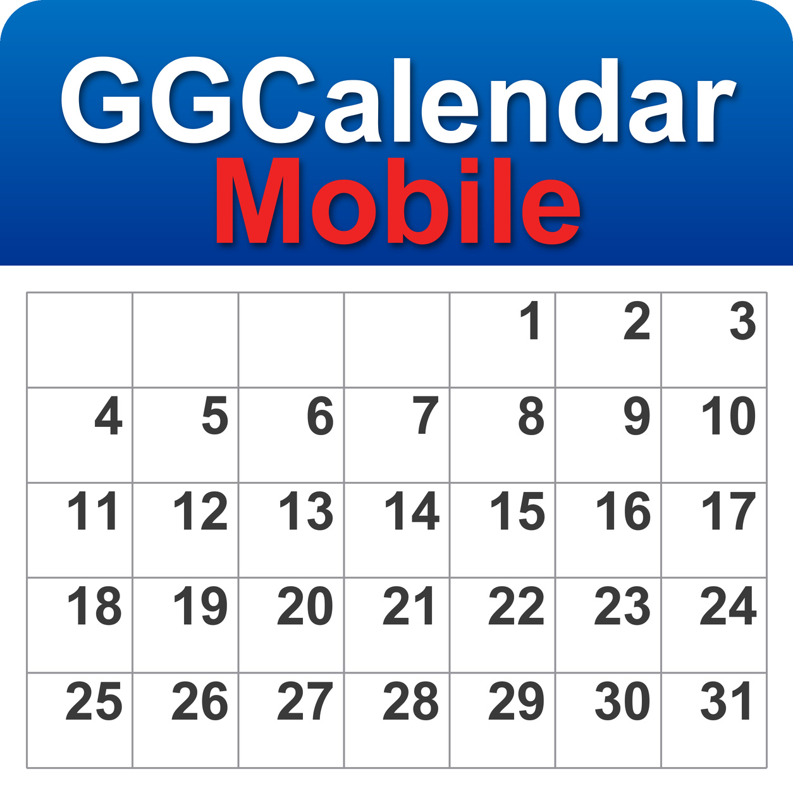

<p align="center"></p>

<h1 align="center">GGCalendar Mobile</h1>

<p align="center"><a href="https://github.com/giansalvo/GGCalendarMobile/actions/workflows/ci.yml"></a></p>

<p align="center">Calendario per Android con sincronizzazione Google Calendar · <em>Android calendar with Google Calendar sync</em></p>

<p align="center">
  <a href="https://profgusinu.altervista.org/GGCalendarAndroid/">Sito</a> ·
  <a href="https://profgusinu.altervista.org/GGCalendar/privacy.html">Privacy</a> ·
  <a href="https://github.com/giansalvo/GGCalendar">GGCalendar per Windows</a> ·
  <a href="LICENSE">Licenza GPL v3 o successive</a>
</p>

---

> **Stato:** ultima versione pubblicata 1.0.5. L'APK firmato è nella pagina [Release](https://github.com/giansalvo/GGCalendarMobile/releases).
> **Status:** latest release 1.0.5. The signed APK is on the [Releases](https://github.com/giansalvo/GGCalendarMobile/releases) page.

## Installazione e primo accesso

1. Scarica l'APK (`GGCalendar-<versione>.apk`) dalla pagina [Release](https://github.com/giansalvo/GGCalendarMobile/releases) e, se vuoi, controlla l'impronta con il file `.sha256` (`certutil -hashfile GGCalendar-<versione>.apk SHA256` su Windows, `sha256sum` su Linux e macOS).
2. Apri il file sul telefono e consenti l'installazione da questa fonte quando Android lo chiede. Serve Android 8 o successivo.
3. Se vuoi aggiungi il tuo account Google dal menu dell'app.

> **Nota: "Google non ha verificato questa app".** L'accesso ai dati del calendario non ha ancora completato la verifica di Google, quindi al primo accesso Google mostra l'avviso *"Google non ha verificato questa app"*. È previsto e non indica un problema dell'app: tocca **Avanzate**, poi **Vai a GGCalendar (non sicuro)** e concedi l'accesso al calendario. Il codice è pubblico in questo repository e l'app non ha server propri (vedi la [privacy](https://profgusinu.altervista.org/GGCalendar/privacy.html)). Finché l'app non è verificata, Google limita a 100 il numero di utenti che possono autorizzarla.
>
> *Note: "Google hasn't verified this app". Access to calendar data has not yet completed Google's verification, so Google shows this warning the first time you sign in. It is expected: tap **Advanced**, then **Go to GGCalendar (unsafe)**, and grant calendar access. Until the app is verified, Google limits it to 100 users.*

## Funzionalità

- Viste programma, giorno, 6 giorni, settimana e mese
- Sincronizzazione bidirezionale con uno o più account Google Calendar, anche offline, con gestione dei conflitti
- Eventi ricorrenti, invitati, link Google Meet
- Promemoria con notifica, sveglia ed email inviata da Google
- Condivisione ed esportazione (`.ics`, CSV)
- Calendari locali sul telefono con eventi, ricorrenze e promemoria come gli altri
- Abbonamento a calendari pubblici in sola lettura
- Importazione di un file `.ics` o di un indirizzo iCal in un calendario locale
- Secondo fuso orario
- Registro diagnostico facoltativo inviabile per mail dal menu laterale
- Lingue supportate: Italiano, inglese, spagnolo e tedesco
- Temi: chiaro e scuro

È la versione Android di [GGCalendar per Windows](https://github.com/giansalvo/GGCalendar): stessa logica di sincronizzazione e stesso progetto Google.

## Compilare dal codice sorgente

Requisiti: [Android Studio](https://developer.android.com/studio) (include JDK e Android SDK).

```powershell
git clone https://github.com/giansalvo/GGCalendarMobile.git
cd GGCalendarMobile
.\gradlew.bat assembleDebug
.\gradlew.bat test
```

Oppure apri la cartella in Android Studio ed esegui la configurazione `app`.

### Credenziali Google

L'app usa le Google Calendar API tramite Google Play Services. Google riconosce l'app dal nome del pacchetto e dall'impronta SHA-1 del certificato di firma, quindi non ci sono segreti nel repository. Per usare la sincronizzazione con una build firmata da te serve un tuo progetto Google Cloud:

1. In [Google Cloud Console](https://console.cloud.google.com/) abilita la **Google Calendar API** e configura la schermata di consenso OAuth con l'ambito `https://www.googleapis.com/auth/calendar`.
2. Crea un ID client OAuth di tipo **Android** con il nome del pacchetto e lo SHA-1 del tuo certificato (`.\gradlew.bat signingReport`).
3. Se distribuisci una versione modificata, cambia anche `applicationId` (vedi i termini aggiuntivi sotto).

### Firma della release

Crea un file `keystore.properties` nella radice del progetto (è escluso da git):

```properties
storeFile=percorso/del/keystore.jks
storePassword=...
keyAlias=...
keyPassword=...
```

## Struttura del progetto

| Modulo | Contenuto |
|---|---|
| `app` | Applicazione: attività, tema, icona, dependency injection |
| `core/model` | Modelli di dominio, lettura e scrittura iCalendar, indirizzi degli abbonamenti, scrittore del file di registro (`FileLog`) |
| `core/network` | Client delle Google Calendar API e lettore degli indirizzi iCal (`https`, limiti, `ETag`) |
| `core/auth` | Accesso Google (scelta dell'account e autorizzazione) |
| `core/database` | Database Room (schema versione 7) |
| `core/data` | Sincronizzazione, calendari locali, abbonamenti (cifratura dell'indirizzo, filtro dei giorni), importazione di file e indirizzi iCal, secondo fuso orario, ricorrenze |
| `core/notifications` | Promemoria, sveglie, schermata di avvio e registro diagnostico (file di registro, invio per mail) |
| `feature/calendar` | Schermata principale: menu laterale, viste, colonna del secondo fuso, abbonamenti, finestra di importazione |
| `feature/event` | Dettaglio e modifica di un evento |
| `feature/settings` | Impostazioni |

## Privacy

GGCalendar non ha server propri e non raccoglie telemetria. I dati restano sul telefono e, se colleghi un account Google, viaggiano solo tra il telefono e Google. I dettagli sono nell'[informativa sulla privacy](https://profgusinu.altervista.org/GGCalendar/privacy.html).

## Licenza

Copyright © 2026 Giansalvo Gusinu.

GGCalendar Mobile è software libero: puoi ridistribuirlo e/o modificarlo secondo i termini della GNU General Public License pubblicata dalla Free Software Foundation, versione 3 della licenza o (a tua scelta) qualsiasi versione successiva. È distribuito nella speranza che sia utile, ma **senza alcuna garanzia**, nemmeno quella implicita di commerciabilità o di idoneità a uno scopo particolare. Il testo completo è nel file [LICENSE](LICENSE).

### Termini aggiuntivi (GPL v3, sezione 7)

Il nome "GGCalendar" e il logo (file `img/GGCalendarMobile_logo.jpg` e le icone dell'app in `app/src/main/res/`) identificano l'app originale dell'autore:

- ai sensi della sezione 7(e), la licenza non concede alcun diritto d'uso del nome e del logo come marchi;
- ai sensi della sezione 7(c), chi distribuisce una versione modificata deve usare un nome, un logo e un `applicationId` diversi, così che non sia confusa con l'originale. È consentito dichiarare che deriva da GGCalendar.
